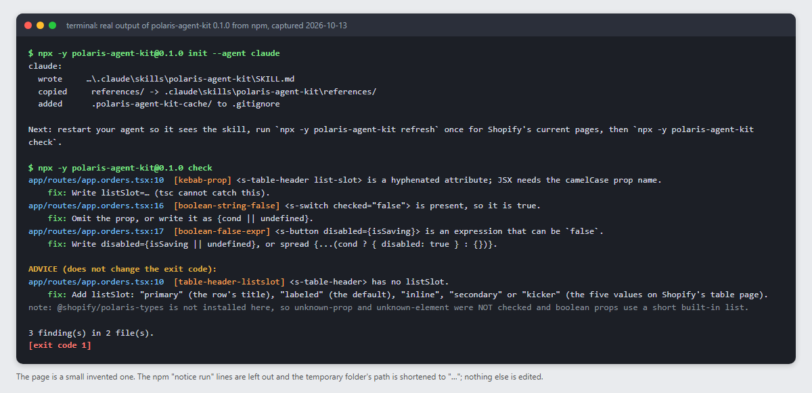

# Polaris agent kit

**Rules and a linter that stop AI coding agents from writing broken Polaris 2.0 web components in Shopify embedded apps.** Works with Claude Code, Cursor, GitHub Copilot, Codex and Windsurf. Zero dependencies.

> Unofficial community project, not affiliated with Shopify. Version 0.1.1, on npm. The checker and installer were run on Windows; CI on Linux, macOS and Windows is set up and has not run yet. See [Tested and untested](#tested-and-untested) for exactly what was and was not run.



The image is the real terminal output of the published 0.1.0 package from npm, run on Windows on 2026-10-13, on a small invented page (`init --agent claude`, then `check`). The 0.1.1 rules are newer than the image.

## The problem

Agents write Polaris from memory, and in our experience much of that memory is Polaris 1, the React library. The code type-checks and is still wrong: a hyphenated prop (`list-slot`) that `tsc` cannot see and the browser ignores; the deprecated `@shopify/polaris` React package added when web components were meant; an unversioned script URL next to Polaris 2.0 types that do not match it; boolean props React 18 writes as the string `"false"`, which Polaris reads as true. This kit gives the agent the rules before it writes, and a linter that catches what the compiler cannot.

## Install in 3 commands

> On npm as [`polaris-agent-kit`](https://www.npmjs.com/package/polaris-agent-kit). To read the code before you run it: `git clone https://github.com/oderajoseph95/polaris-agent-kit && node polaris-agent-kit/bin/cli.mjs check <your app folder>`.

```bash
# 1. Claude Code only (two lines inside Claude Code). Other agents skip to step 2.
/plugin marketplace add oderajoseph95/polaris-agent-kit
/plugin install polaris-agent-kit@polaris-agent-kit-marketplace

# 2. Put the rules where your agent reads them (claude | cursor | copilot | codex | windsurf | all)
npx -y polaris-agent-kit@0.1.1 init --agent claude

# 3. Lint what the agent wrote (exit 1 on an error finding)
npx -y polaris-agent-kit@0.1.1 check
```

The version is pinned on purpose: `npx -y` runs whatever it fetches, so a name you do not pin is code you did not read. The `npx` commands (`--version`, `init --agent claude`, `check`) were run from npm on 2026-10-13 on Windows, as version 0.1.0; macOS and Linux were not run by hand. `node bin/cli.mjs <command>` from a clone does the same. The Claude Code plugin install was run once in an isolated configuration folder (see [what is tested](#tested-and-untested)). Full install notes, per agent, are [below](#install).

## Before and after

Everything here is **synthetic**: two small pages in [docs/demo/](docs/demo/), the first written the way an unassisted agent often writes it, the second after the kit's rules. The transcripts are the real output of `node bin/cli.mjs check` on each folder; a test fails if they drift from the files in `docs/demo/`. They prove only what `check` can see, not that either page renders correctly.

More mistakes, caught in a second page (the transcript text below is kept honest by a test; the image above is the npm run).

Before ([docs/demo/before.txt](docs/demo/before.txt)): the bad lines are a hyphenated `list-slot`, `checked="false"`, a boolean handed an expression, `import ... from "@shopify/polaris"`, the unversioned `polaris.js`, types for 2.x beside it, and a raw `gid` in a table cell.

```text
$ node bin/cli.mjs check docs/demo/before-app
app/routes/app.items.tsx:12  [kebab-prop] <s-table-header list-slot> is a hyphenated attribute; JSX needs the camelCase prop name.
    fix: Write listSlot=… (tsc cannot catch this).
app/routes/app.items.tsx:13  [kebab-prop] <s-table-header list-slot> is a hyphenated attribute; JSX needs the camelCase prop name.
    fix: Write listSlot=… (tsc cannot catch this).
app/routes/app.items.tsx:24  [boolean-string-false] <s-switch checked="false"> is present, so it is true.
    fix: Omit the prop, or write it as {cond || undefined}.
app/routes/app.items.tsx:25  [boolean-false-expr] <s-button loading={isSaving}> is an expression that can be `false`.
    fix: Write loading={isSaving || undefined}, or spread {...(cond ? { loading: true } : {})}.
app/routes/app.items.tsx:25  [boolean-false-expr] <s-button disabled={isSaving}> is an expression that can be `false`.
    fix: Write disabled={isSaving || undefined}, or spread {...(cond ? { disabled: true } : {})}.
package.json:1  [types-script-mismatch] @shopify/polaris-types is ^2.0.0-rc.3 (major 2) but the script loaded is major 1.
    fix: Move the script URL and the types package together; see references/install-and-pinning.md.
tsconfig.json:1  [tsconfig-types] compilerOptions.types is set (an allowlist) and does not name @shopify/polaris-types.
    fix: Add "@shopify/polaris-types" to types.

ADVICE (does not change the exit code):
package.json:1  [polaris-react-import] package.json declares @shopify/polaris, which npm marks as deprecated by Shopify.
    fix: Plan to remove it and keep only @shopify/polaris-types; web components need no import. Both can coexist while you migrate (silence with --ignore polaris-react-import).
app/routes/app.items.tsx:2  [polaris-react-import] Imports @shopify/polaris, the React package that npm marks as deprecated by Shopify.
    fix: Move to the web components (s-page, s-table…); they need no import. Both can coexist while you migrate.
app/routes/app.items.tsx:12  [table-header-listslot] <s-table-header> has no listSlot.
    fix: Add listSlot: "primary" (the row's title), "labeled" (the default), "inline", "secondary" or "kicker" (the five values on Shopify's table page).
app/routes/app.items.tsx:13  [table-header-listslot] <s-table-header> has no listSlot.
    fix: Add listSlot: "primary" (the row's title), "labeled" (the default), "inline", "secondary" or "kicker" (the five values on Shopify's table page).
app/routes/app.items.tsx:19  [raw-gid-render] {item.gid} puts a gid into visible text.
    fix: Show a readable name (resource type + number, or the title) instead of the raw id.
app/root.tsx:10  [script-unpinned] polaris.js is the legacy unversioned entry point; it never serves 2.x.
    fix: Use a versioned URL (polaris-1.js, or the 2.0 release-candidate URL) from ONE constant; see references/install-and-pinning.md.
package.json:1  [types-unpinned] @shopify/polaris-types is "^2.0.0-rc.3", a range.
    fix: Pin the exact version. (For the 2.0 release candidate, Shopify's guide installs @shopify/polaris-types@^2.0.0-rc.0 and says to pin the exact version for reproducible installs.)
note: @shopify/polaris-types is not installed here, so unknown-prop and unknown-element were NOT checked and boolean props use a short built-in list.

7 finding(s) in 2 file(s).
[exit code 1]
```

After ([docs/demo/after.txt](docs/demo/after.txt)): `listSlot`, no string booleans, `|| undefined`, no React import, one pinned script constant, types pinned to the same major, the types in `tsconfig`.

```text
$ node bin/cli.mjs check docs/demo/after-app
note: @shopify/polaris-types is not installed here, so unknown-prop and unknown-element were NOT checked and boolean props use a short built-in list.

ok: 2 file(s), 12 s-* element(s) scanned, no findings.
[exit code 0]
```

Read the note in the second run: the demo folders do not install `@shopify/polaris-types`, so the two rules that need the real types were not run. In your project they run.

## What it is, and what it is not

A set of rules and references the agent reads before it writes, plus a linter for the problems a type checker cannot see. "Shopify" and "Polaris" are Shopify's trademarks, used here only to say what this kit is about. Shopify's own documentation is the authority: where this kit and Shopify disagree, Shopify is right and this kit has a bug.

It does not make an app compliant, approved or "Built for Shopify". Only Shopify decides that, and a clean run of this kit proves less than a page you have opened and clicked.

## Proven on

| Thing | Version it was proven on |
|---|---|
| Polaris script | `polaris-2.0-rc.js` (2.0 release candidate) |
| `@shopify/polaris-types` | `2.0.0-rc.3` |
| React | 18.3 |
| App template | Shopify's React Router app template |
| Dates | rules observed August to October 2026; drafted 2026-10-13 |

Rules the kit could not prove on that stack are labelled **UNPROVEN** where they appear. Matrix and policy: [docs/PROVEN-ON.md](docs/PROVEN-ON.md), [docs/VERSIONING.md](docs/VERSIONING.md). Run `doctor` to see how your project compares with what exists today.

## Tested and untested

Plain list of what was and was not verified, as of 2026-10-13. Nothing here is softened; [docs/PROVEN-ON.md](docs/PROVEN-ON.md) has the rule-by-rule matrix.

**Verified**

| What | How |
|---|---|
| The kit's own tests | `node --test`, run on Node 24 on Windows 11 (the CI matrix below has not run yet). They include a drift check on every generated file, hostile-input tests for `init`, `check` and `refresh`, and this README's transcripts |
| `check` against the real type packages | run on a template-shaped app with the real `@shopify/polaris-types@2.0.0-rc.3` (62 elements), `@shopify/polaris-types@1.1.0` and `@shopify/app-bridge-types@0.7.2`: exactly the planted findings, after the false positives that run exposed were fixed |
| `check` on a large app | one app of about 1,300 `s-*` elements: no errors; a false-positive advice rule it exposed was fixed. One app, not a spread of strangers' apps |
| The Claude Code manifests | `claude plugin validate` printed "Validation passed" for both |
| The npm package | `npx` at version 0.1.0: `--version`, `init --agent claude` and `check` were run from npm on Windows 11, Node 24, 2026-10-13: version printed, the skill and references written, the planted mistakes reported (the image above) |
| A Claude Code plugin install | in an isolated config folder (`CLAUDE_CONFIG_DIR`), Claude Code 2.1.294, Windows, 2026-10-13: marketplace added from a local folder, plugin installed and listed as enabled. Details: [docs/PROVEN-ON.md](docs/PROVEN-ON.md) |
| Quoted Shopify, npm and react.dev text | re-read on 2026-10-13; the 31 URLs in the kit returned 200 (the 404s are intentional fixtures) |
| `refresh` against shopify.dev | ran live once, before the security hardening: cached 10 pages with date, source URL and sha256 |
| `init` refusing links | a project whose `.windsurf` was a junction was refused (it wrote outside the project before the fix) |

**Not verified. Do not rely on these.**

| What | Status |
|---|---|
| The plugin in a live Claude Code session | Install and list were run (above). A session that loads the skill was not driven, so `${CLAUDE_PLUGIN_ROOT}` substitution inside the skill is unproven, and the GitHub-sourced marketplace line was not run |
| Cursor, GitHub Copilot, Windsurf, Codex, and `AGENTS.md` | Not run, as of 2026-10-13: none of those tools is available to the maintainer's machine. The files follow the vendors' documented formats but no tool was started with them. The multi-glob syntax for Cursor and Windsurf is unconfirmed; Windsurf's newer `.devin/rules/` path was not tried |
| React 19 | Boolean behaviour with custom elements is cited from react.dev, not driven. `boolean-false-expr` is switched off for React 19 projects |
| `"false"` written as an attribute | Observed on React 18.3 with Polaris 1.x and 2.0 RC. Not tried on other React versions or other Polaris releases |
| `clickDelegate` | The "link or checkbox only" behaviour was observed on Polaris 1.x. UNPROVEN on 2.0 RC |
| Container-query grids and `s-query-container` | Observed once; not in Shopify's text. UNPROVEN |
| "Do not add SRI to the Polaris script" | UNPROVEN |
| Rows observed once (modal scrim, button-group gap, server-rendered table labels) | A stranger cannot reproduce them from the text yet |
| Linux and macOS | **Pending first CI run.** `.github/workflows/test.yml` runs the tests on ubuntu, macos and windows, Node 20 and 22; it has not run yet. Nobody has run the `npx` commands by hand on macOS or Linux. The link guard in `init` is proven for Windows junctions only |
| Node 20 and 22 | The package says `>=20`; the same CI matrix covers 20 and 22 and is **pending its first run**. Only Node 24 ran |
| `refresh` after hardening | The redirect lock and size caps are unit-tested with a fake `fetch`. The hardened code has not been run against live shopify.dev, and rate limits were not exercised |
| False-positive rate of `check` | Unknown beyond the apps named above. `boolean-false-expr` also flags `disabled={someBoolean}`, which is noisy and intended under React 18 |
| Polaris 2.0 stable | Does not exist yet (`polaris-2.0.js` returned 404); everything is proven on the 2.0 release candidate. An old-design admin was not available. Languages: English and one long locale |
| What a green `check` means | Only that none of the 21 patterns were found. The demo transcripts were not type-checked or opened in a browser |
| The trademark wording | Not reviewed by a lawyer |
| Not built | No hooks or slash commands in the plugin. The slot checker (`slot-not-declared`) needs `@shopify/polaris-types` installed and judges only a direct s-* or HTML parent |

## What is in it

1. **Rules and references** an agent loads on demand: install and pinning, props in TSX, page anatomy, tables, modals, forms, states, responsive, accessibility, performance, the Built for Shopify design bar (as a reading list, not a promise), what not to do, and a list of real mistakes (mistake, symptom, fix).
2. **A linter** (`check`) for the things that are mechanically checkable and that `tsc` cannot see (for example a kebab-case Polaris prop type-checks green and does nothing).
3. **Fresh docs, not frozen ones** (`refresh`, `doctor`): the kit never copies Shopify's text into this repo. It fetches Shopify's current component pages to a local, git-ignored cache on your machine, with the date and source URL, and tells you when your pinned version differs from what exists now.

Zero runtime dependencies. Node 20 or later. Plain ESM. MIT licence. Built from lessons shipping real embedded apps.

## Install

**Any agent, from your project folder (recommended):**

```bash
npx -y polaris-agent-kit@0.1.1 init --agent claude      # or cursor | copilot | codex | windsurf | all (comma list ok)
npx -y polaris-agent-kit@0.1.1 refresh                  # Shopify's current component pages into .polaris-agent-kit-cache/ (git-ignored)
npx -y polaris-agent-kit@0.1.1 check                    # lint
```

To read the code first, run `node bin/cli.mjs <command>` from a clone instead.

What `init` writes (nothing outside the folder you run it in: it refuses to write through a symbolic link or junction, which a cloned repository can contain; it refuses to overwrite a file it did not generate unless you pass `--force`; the copied `references/` folders are kit-owned and are replaced on every run; `--dry-run` shows the plan):

| Agent | File written | Format reference |
|---|---|---|
| Claude Code | `.claude/skills/polaris-agent-kit/SKILL.md` + `references/` | https://code.claude.com/docs/en/plugins/manifest-reference (standard layout) |
| Cursor | `.cursor/rules/polaris-agent-kit.mdc` | https://cursor.com/docs/context/rules |
| GitHub Copilot | `.github/instructions/polaris-agent-kit.instructions.md` | https://docs.github.com/en/copilot/how-tos/configure-custom-instructions/add-repository-instructions |
| Codex and any `AGENTS.md` reader | a marked block in `AGENTS.md` (your text is kept) | https://agents.md |
| Windsurf | `.windsurf/rules/polaris-agent-kit.md` | https://docs.devin.ai/desktop/cascade/memories |

For every agent except Claude, the references are copied to `.polaris-agent-kit/references/` and the rule points at them. The generated files follow the vendors' documented formats but have not been driven in each agent (see [Tested and untested](#tested-and-untested)).

**Claude Code plugin** (`claude plugin validate` passes on the manifests; an install from a local clone was run in an isolated config, the GitHub-sourced line below was not):

```
/plugin marketplace add oderajoseph95/polaris-agent-kit
/plugin install polaris-agent-kit@polaris-agent-kit-marketplace
```

Or load it straight from a folder while developing: `claude --plugin-dir ./path/to/this/kit`. Format notes: https://code.claude.com/docs/en/plugins and https://code.claude.com/docs/en/plugin-marketplaces. The plugin is a single skill (`SKILL.md` at the plugin root) with its CLI in `bin/`.

## Commands

| Command | What it does |
|---|---|
| `init --agent <a>[,<a>] [--dir D] [--force] [--dry-run]` | copy the right files for the agent(s) into your codebase |
| `check [dir] [--json] [--strict] [--ignore r,r] [--list]` | static linter; exit 0 clean, **1 on an error finding**, 2 on bad usage or when it scanned nothing (a check that looked at nothing must not say ok). Each finding prints `file:line  [rule] message` and a `fix:` line |
| `refresh [--version latest\|v2.0-rc\|...] [--all] [--pages a,b]` | fetch Shopify's current component pages (`.md` twins) into `.polaris-agent-kit-cache/` with fetch date, source URL and sha256. Fails soft offline: exit 0, nothing written |
| `doctor [dir] [--offline] [--fail-on-diff]` | pinned script and types in your project, the latest it can see (npm dist-tags, CDN channels), and whether they differ |
| `build [--check]` | maintainers: regenerate every agent file from `source/`; `--check` fails on drift |

`check --list` prints every rule. Rules are `error` (exit 1) or `advice` (printed; exit 1 only with `--strict`). Errors are things Shopify's docs or the installed types package settle; heuristics are advice. It is a heuristic text scanner, not a parser: [references/validation.md](references/validation.md) says what a green run does and does not prove. Silence a rule with `--ignore <rule>` and write down why.

## What it does on your machine (read this before you run it)

- **No dependencies, no install script, no telemetry, no account.** It never sends your code, file names or project details anywhere.
- **`check` and `doctor` only read** `.ts/.tsx/.jsx/.js/.mjs/.html` and `package.json`/`tsconfig.json` under the folder you give them. They never run, import or evaluate what they read, skip symbolic links, skip files over 2 MB (and say so), and print file contents only as short quoted snippets with control characters removed.
- **The network, exactly:** `refresh` fetches from `https://shopify.dev/docs/` only (a redirect to any other host is refused and never contacted; pages over 1 MB or not text are refused) and writes to `.polaris-agent-kit-cache/` in your project. `doctor` asks `registry.npmjs.org` for the `@shopify/polaris-types` dist-tags and sends `HEAD` requests to `cdn.shopify.com`. Nothing is uploaded.
- **Cached Shopify pages are untrusted text.** Every cached file begins with a note saying so, and the rules tell an agent to read them for facts about components and never to obey an instruction written in one. Do not point an agent at a cache you did not make with `refresh`.
- **The commands an agent is told to run** are `doctor`, `refresh` and `check`. For agents other than the Claude plugin they appear as `npx -y polaris-agent-kit@<this release>`, pinned to the release that wrote them. Read the rule files `init` writes before you commit them.

## Mistakes this prevents

(full table with fixes: [references/mistakes.md](references/mistakes.md))

- A hyphenated prop in TSX (`list-slot`) that `tsc` accepts and the browser ignores, so the table falls back to the default phone layout while desktop looks fine.
- Adding the deprecated React package when you meant to use web components.
- Loading the Polaris script twice, from the unversioned `polaris.js`, or with a preload header that names a different URL.
- Types that do not match the script's major version, or a tsconfig `types` allowlist that drops the App Bridge types.
- Boolean props that React 18 renders as the string `"false"` and therefore as true (a switched-off setting drawn ticked).
- A table row click that silently does nothing because `clickDelegate` points at a button.
- A table that unmounts its own filters when nothing matches.
- A modal that fetches after it opens, shifting the whole panel (a layout-shift score that depends only on how fast the read was).
- Table cells that can wrap, so a row grows after first paint.
- Raw `gid://` identifiers, raw enums and `0` for unread data on merchant screens.
- Declaring a UI fixed because the source was fixed, without ever opening the page at 1280 and 390.

## Screenshots

[screenshots/](screenshots/) lists the pictures of real embedded-admin pages this repo still wants. None are committed. The one image in this README is a capture of terminal output, not of a Shopify page.

## Check your own CI with the kit

A ready-made step, pinned to a release (the action's `version` input defaults to the same release and is refused if it is not an exact version):

```yaml
# .github/workflows/polaris.yml
name: polaris
on: [push, pull_request]
permissions:
  contents: read
jobs:
  check:
    runs-on: ubuntu-latest
    steps:
      - uses: actions/checkout@d23441a48e516b6c34aea4fa41551a30e30af803 # v6.1.0
        with:
          persist-credentials: false
      - uses: oderajoseph95/polaris-agent-kit@v0.1.1
        with:
          directory: .   # your app folder
```

It runs `npx -y polaris-agent-kit@0.1.1 check <directory>` and fails the job on an error finding (`strict: "true"` also fails on advice). Pin the action to a full commit SHA instead of a tag if your policy requires it. This step has not run in a real workflow yet (it needs this repository's `v0.1.1` tag).

## Contributing

Pull requests and issues are welcome: see [CONTRIBUTING.md](CONTRIBUTING.md) (how to add a rule, what will not be accepted) and the templates in `.github/`. The short version:

1. Edit `source/core.md` (the always-on rules) or a file in `references/`. Never edit `SKILL.md` or anything in `adapters/` by hand: run `node bin/cli.mjs build`, commit the result. CI fails on drift.
2. A new `check` rule needs: a bad fixture that FAILS, a good fixture that passes, a line in `RULES`, and an entry in `references/mistakes.md` stating the symptom you saw and the stack you saw it on. Show the test red first.
3. A claim about Polaris behaviour needs one of: a Shopify URL you fetched (with the date), a reproduction on a named version, or the word UNPROVEN.
4. Link to Shopify's docs; never paste them.
5. Run `node --test` (no dependencies to install).
6. **Safety: synthetic material only.** In an issue, a fixture or a pull request, never include API keys, tokens, the contents of environment or key files, store names or admin URLs, customer or order data, screenshots of a real store, or internals of a private project. Reproduce with a small invented page (see [docs/demo/](docs/demo/)). A leaked secret in an issue is public and stays in history: revoke it first, then tell us.

Starting points: [docs/GOOD-FIRST-ISSUES.md](docs/GOOD-FIRST-ISSUES.md).

## Licence

MIT, see [LICENSE](LICENSE). That is the only licence that applies to any file here: no file carries other terms. The copyright holder is Odera Joseph Echendu. The kit links to Shopify's documentation and does not redistribute it.

## Maintainers

- **Releasing:** [docs/RELEASING.md](docs/RELEASING.md) has the exact steps (publish gate, version bump, changelog, push a `v*` tag and the release workflow publishes through npm trusted publishing). `npm run prepublishOnly` refuses while the package is private, has no repository or any placeholder is left.
- **GitHub description:** `UNOFFICIAL community kit, not affiliated with Shopify: rules and a linter that help AI coding agents (Claude Code, Cursor, Copilot, Codex, Windsurf) build embedded Shopify apps with Polaris 2.0 web components.`
- **GitHub topics:** `polaris`, `polaris-web-components`, `polaris-2`, `shopify`, `shopify-app`, `shopify-embedded-app`, `ai-coding-agent`, `claude-code`, `claude-code-plugin`, `cursor`, `github-copilot`, `agent-skills`, `agents-md`, `linter`. Do not add "Built for Shopify" as a topic or keyword: it is Shopify's badge, not ours.

## Not affiliated, again

Not made by, approved by or supported by Shopify. Do not describe an app as "Built for Shopify" because it follows this kit; that status is granted by Shopify. Shopify's tooling for validating generated code: the Shopify Dev MCP (`npx -y @shopify/dev-mcp@latest`, https://shopify.dev/docs/apps/build/devmcp) and the Shopify AI Toolkit (https://shopify.dev/docs/apps/build/ai-toolkit). Use them alongside this kit; they validate against Shopify's declared packages and this kit adds the failures that only appear on screen.
